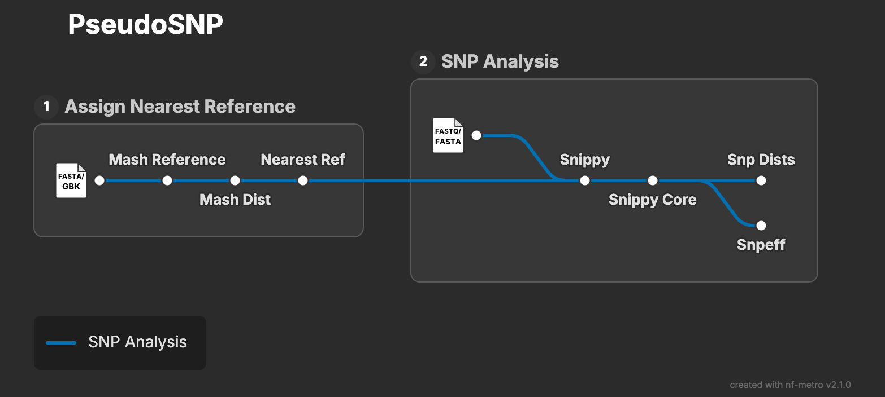

# PseudoSNP

**PseudoSNP** is a nextflow pipeline for SNP analysis of Pseudomonas aeruginosa samples.



## Setup

1. First ensure you have [Nextflow](https://docs.seqera.io/nextflow/install#installation) installed
2. Next ensure you have either [Docker](https://docs.docker.com/engine/install/) or [Singularity](https://docs.sylabs.io/guides/3.0/user-guide/) installed
3. Clone the repo with ``git clone https://github.com/tmorr-12/PseudoSNP``

## Usage

```
nextflow run main.nf --input <path/to/manifest.csv> --refs <path/to/refs>
```

## Workflow

Samples are assigned to phylogroup's PAO1, PA14 or PA7, then calls snps based on it's reference with [Snippy](https://github.com/tseemann/snippy). [snp-dists](https://github.com/tseemann/snp-dists) is used to output a SNP distance matrix and [SnpEff](https://pcingola.github.io/SnpEff/) annotates and predicts the effects of genetic variants.

**PseudoSNP** takes two inputs: a directory containing PAO1, PA14 and PA7 references (fasta & gbff/gbk format) and an input manifest. References can be obtained by running the `get_refs.sh` script found in this repo. The input manifest must be in the following format:

```
ID,R1,R2,fasta
sample_A,<path/to/sample_A.fastq>,<path/to/sample_A.fastq>,<path/to/sample_A.fasta>
sample_B,<path/to/sample_B.fastq>,<path/to/sample_B.fastq>,<path/to/sample_B.fasta>
...
```